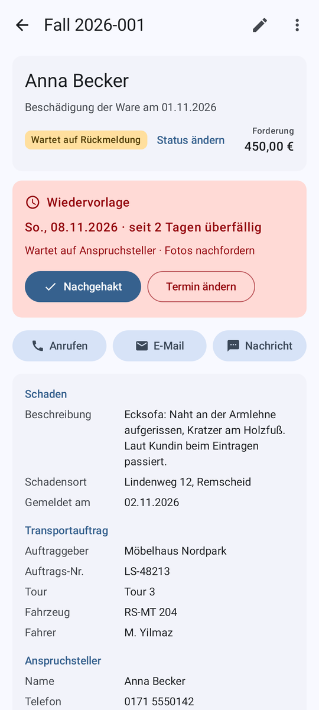
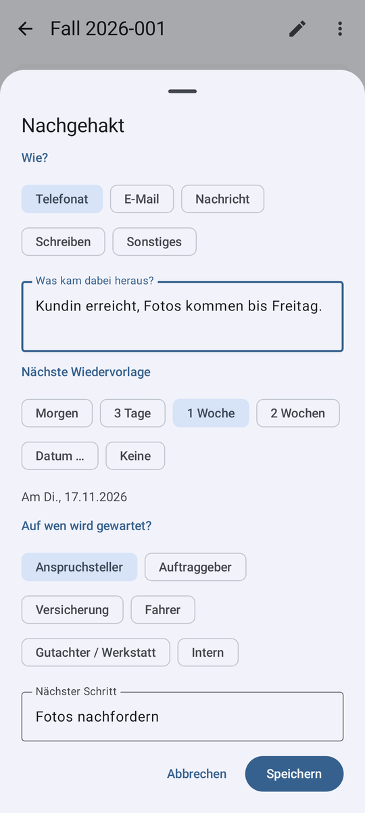
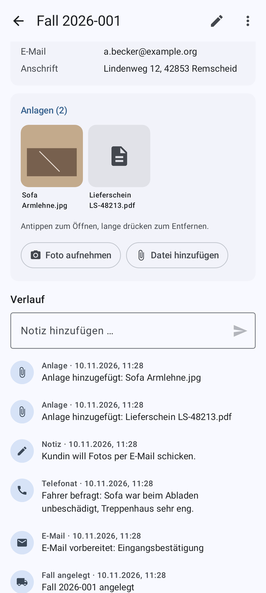
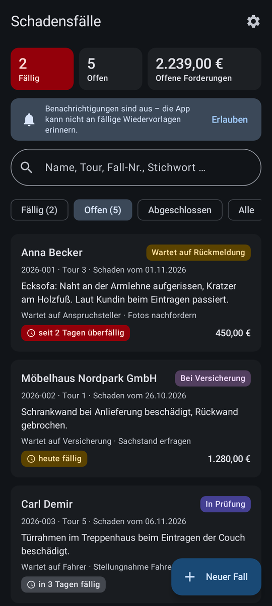

# Schadensfälle

Android-App zum **Nachhaken und Bearbeiten von Schadensfällen bei Transportaufträgen**.
Jeder Fall bekommt eine Wiedervorlage; die App zeigt jeden Tag, bei wem nachgehakt werden muss,
und hält fest, was dabei herauskam.

| Übersicht | Fall | Nachgehakt |
|---|---|---|
|  |  |  |

| Anlagen und Verlauf | Textvorlagen | Dunkles Design |
|---|---|---|
|  |  |  |

Die Bilder zeigen erfundene Beispieldaten.

## Was die App kann

**Fälle führen**
- Fall anlegen mit Anspruchsteller, Schaden (Datum, Art, Beschreibung, Ort, geforderter Betrag),
  Transportauftrag (Auftraggeber, Auftrags-Nr., Tour, Fahrzeug, Fahrer) und Regulierung
  (Vergleichsbetrag, Zahlungsfrist, Schadennummer der Versicherung)
- Laufende Fallnummer je Jahr (`2026-001`, `2026-002`, …)
- Status: Neu · In Prüfung · Wartet auf Rückmeldung · Bei Versicherung · Vergleich angeboten ·
  Zahlung offen · Erledigt · Abgelehnt
- Fotos direkt aufnehmen, Belege und andere Dateien anhängen

**Nachhaken**
- Wiedervorlage je Fall mit „Wartet auf …“ und nächstem Schritt
- Übersicht sortiert nach Dringlichkeit: überfällige Fälle oben, Reiter *Fällig / Offen / Abgeschlossen / Alle*, Suche über alle Felder
- **Nachgehakt** mit einem Tipp: Kanal und Ergebnis festhalten, nächsten Termin wählen (morgen, 3 Tage, 1 Woche, 2 Wochen, Datum)
- Tägliche Erinnerung per Benachrichtigung zur eingestellten Uhrzeit
- Anrufen, E-Mail und Nachricht direkt aus dem Fall, mit Textvorlagen:
  Eingangsbestätigung, Unterlagen anfordern, Erinnerung, Zwischenbescheid, Sachstandsanfrage

**Nachvollziehen und Weitergeben**
- Verlauf je Fall: Statuswechsel, Termine, Kontakte, Anlagen und Notizen mit Zeitstempel
- Fallliste als CSV für Excel exportieren (Semikolon, deutsches Zahlenformat)
- Zusammenfassung eines Falls als Text teilen
- Backup aller Fälle samt Anlagen als ZIP erstellen und wiederherstellen

Die Textvorlagen sind bewusst **haftungsneutral**: Sie erkennen keine Haftung an und lehnen
sie nicht ab. Ablehnungs- und Vergleichsschreiben entstehen weiterhin außerhalb der App.

## Installieren

1. In GitHub unter **Actions** den neuesten erfolgreichen Lauf öffnen und unter *Artifacts*
   `Schadensfaelle-debug-apk` herunterladen (ZIP mit der APK-Datei).
2. Die APK auf dem Android-Gerät öffnen und die Installation aus dieser Quelle erlauben.
3. Beim ersten Start unter **Einstellungen** Firma, Bearbeiter/in und Funktion eintragen –
   daraus entsteht die Grußformel der Textvorlagen – und Benachrichtigungen erlauben.

Voraussetzung: Android 8.0 oder neuer.

### Wichtig bei Updates

Die APK aus dem Workflow ist mit einem bei jedem Lauf neu erzeugten Testschlüssel signiert.
Android installiert eine so gebaute neue Version **nicht über die alte**; die App muss vorher
deinstalliert werden, wobei ihre Daten gelöscht werden. Deshalb vor jedem Update:
**Einstellungen → Backup erstellen**, danach neue Version installieren und
**Backup wiederherstellen**. Wer regelmäßig aktualisieren will, sollte einen festen
Signaturschlüssel einrichten.

## Daten und Datenschutz

- Alle Daten liegen ausschließlich auf dem Gerät. Die App hat keine Internet-Berechtigung.
- Die automatische Cloud-Sicherung von Android ist abgeschaltet, weil die Fälle
  personenbezogene Kundendaten enthalten. Gesichert wird über das Backup in den Einstellungen.
- Anlagen werden in den privaten App-Speicher kopiert; das Original bleibt unverändert.

## Entwickeln

```bash
./gradlew assembleDebug        # APK nach app/build/outputs/apk/debug/
./gradlew testDebugUnitTest    # Tests, erzeugt auch Bildschirmfotos
./gradlew lintDebug            # Android Lint
```

Benötigt JDK 21 und das Android SDK (Plattform 37 wird bei Bedarf nachgeladen).

| Bereich | Technik |
|---|---|
| Oberfläche | Kotlin, Jetpack Compose, Material 3, Navigation Compose |
| Daten | Room (SQLite), DataStore für Einstellungen |
| Erinnerung | WorkManager, Benachrichtigungen |
| Tests | JUnit, Robolectric, Compose UI Test, Roborazzi |

```
app/src/main/java/de/aysetransport/schaden/
├── data/          Datenbank, Repository, Anlagen-Speicher, Backup, Einstellungen
├── domain/        Fachlogik ohne Android: Fälligkeit, Filter, Beträge, Textvorlagen, CSV
├── erinnerung/    tägliche Prüfung und Benachrichtigung
└── ui/            Übersicht, Fall, Formular, Einstellungen
```

Das Datenbankschema ist unter `app/schemas/` versioniert. Wer Tabellen ändert, muss die
Versionsnummer erhöhen und eine Migration ergänzen, sonst gehen beim Update Daten verloren.

### Tests

Die Tests bedienen die App wie ein Nutzer – Fall anlegen, nachhaken, abschließen, löschen,
Foto und Datei anhängen, E-Mail vorbereiten, exportieren, Backup und Wiederherstellung – und
prüfen Fachlogik, Datenbank und Erinnerung. Sie laufen auf dem Entwicklungsrechner in einer
simulierten Android-Umgebung (Robolectric), nicht auf einem echten Gerät.
Bildschirmfotos landen in `app/build/outputs/roborazzi/`.

## Bekannte Grenzen

- Die Erinnerung kommt ungefähr zur eingestellten Uhrzeit; Android darf sie im Stromsparmodus
  verzögern. Manche Hersteller beenden Hintergrundarbeit sehr streng – dann die App in den
  Akku-Einstellungen von der Optimierung ausnehmen. In der Übersicht stehen fällige Fälle
  unabhängig davon immer oben.
- Ein Gerät, ein Bearbeiter: Es gibt keinen Abgleich zwischen mehreren Geräten.
