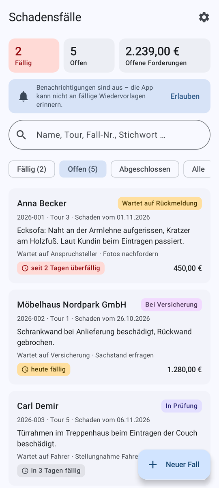

# Schadensfälle

Android-App und Web-App zum **Nachhaken und Bearbeiten von Schadensfällen bei Transportaufträgen**.
Jeder Fall bekommt eine Wiedervorlage; die App zeigt jeden Tag, bei wem nachgehakt werden muss,
und hält fest, was dabei herauskam. Über eine Cloud in Google Drive sehen Handy und Browser
dieselben Fälle – aufgebaut wie bei Tagesdispo und Tourenplanung.

| Übersicht | Fall | Nachgehakt |
|---|---|---|
|  |  |  |

| Anlagen und Verlauf | Textvorlagen | Dunkles Design |
|---|---|---|
|  |  |  |

Die Bilder zeigen erfundene Beispieldaten.

## Was die App kann

**Fälle führen**
- Fall anlegen mit Anspruchsteller, Schaden (Datum, Art, Beschreibung, Ort, geforderter Betrag),
  Transportauftrag (Auftraggeber, Auftrags-Nr., Tour, Fahrzeug, Fahrer, bis zu zwei Beifahrer) und Regulierung
  (Vergleichsbetrag, Zahlungsfrist, Schadennummer der Versicherung)
- Laufende Fallnummer je Jahr (`2026-001`, `2026-002`, …)
- Status: Neu · In Prüfung · Wartet auf Rückmeldung · Bei Versicherung · Vergleich angeboten ·
  Zahlung offen · Erledigt · Abgelehnt
- Fotos direkt aufnehmen, Belege und andere Dateien anhängen

**Nachhaken**
- Wiedervorlage je Fall mit „Wartet auf …“ und nächstem Schritt
- Übersicht sortiert nach Dringlichkeit: überfällige Fälle oben, Reiter *Fällig / Offen / Abgeschlossen / Alle*, Suche über alle Felder
- **Nachgehakt** mit einem Tipp: Kanal und Ergebnis festhalten, nächsten Termin wählen (morgen, 3 Tage, 1 Woche, 2 Wochen, Datum)
- Tägliche Erinnerung per Benachrichtigung zur eingestellten Uhrzeit
- Anrufen, E-Mail und Nachricht direkt aus dem Fall, mit Textvorlagen:
  Eingangsbestätigung, Unterlagen anfordern, Erinnerung, Zwischenbescheid, Sachstandsanfrage

**Nachvollziehen und Weitergeben**
- Verlauf je Fall: Statuswechsel, Termine, Kontakte, Anlagen und Notizen mit Zeitstempel
- Fallliste als CSV für Excel exportieren (Semikolon, deutsches Zahlenformat)
- Zusammenfassung eines Falls als Text teilen
- Backup aller Fälle samt Anlagen als ZIP erstellen und wiederherstellen

Die Textvorlagen sind bewusst **haftungsneutral**: Sie erkennen keine Haftung an und lehnen
sie nicht ab. Ablehnungs- und Vergleichsschreiben entstehen weiterhin außerhalb der App.

## Windows-App

`desktop/` ist die Windows-App: dieselbe Oberfläche wie die Web-App, in einem eigenen Programmfenster
(Electron). Zusätzlich zur Web-App kann sie

- **E-Mail** direkt per IMAP/SMTP senden und empfangen – mit denselben Regeln wie die Android-App
  (Einrichtung unter ⚙ → E-Mail; das Passwort wird über das Windows-Konto verschlüsselt),
- Windows-Benachrichtigungen bei neuen Mails zeigen,
- Anlagen mit den Programmen des Rechners öffnen.

Fälle, Verlauf, Anlagen und Auftraggeber gleichen sich über dieselbe Cloud mit Handy und Browser ab.

**Installieren:** `Schadensfaelle-Setup-<Version>.exe` ausführen. Der Installer ist nicht
signiert; Windows SmartScreen fragt deshalb beim ersten Start nach – „Weitere Informationen →
Trotzdem ausführen“. Installiert wird ohne Administratorrechte für den angemeldeten Benutzer.

**Bauen:** Der Workflow *Windows-App* testet auf einem Windows-Rechner, baut den Installer,
installiert ihn testweise, startet das installierte Programm und stellt den Installer unter
*Actions* als `Schadensfaelle-Windows-Setup` bereit. Lokal: `cd desktop && npm ci && npm test &&
npm run dist:win` (unter Windows) bzw. `npm run dist:win:linux` (Linux mit Wine).

## E-Mail in der App

Unter **Einstellungen → E-Mail** wird das Postfach eingerichtet (Vorlagen für IONOS, STRATO, GMX,
WEB.DE und Telekom, sonst eigene Server-Angaben). Die App spricht direkt per IMAP und SMTP mit
dem Postfach; das Passwort liegt verschlüsselt im Android-Schlüsselspeicher und verlässt das Gerät nicht.

- **Senden:** Im Fall auf *E-Mail* tippen, Vorlage oder „Ohne Vorlage“ für Geschädigten,
  Auftraggeber oder Dritte wählen, im Schreibfenster anpassen, Anlagen des Falls anhängen.
  Der Betreff bekommt die Fallnummer, z. B. `[Fall 2026-001]`. Eine Kopie landet im Ordner
  „Gesendet“ des Postfachs.
- **Zeichen des Auftraggebers:** Steht im Fall unter *Auftraggeber* ein Zeichen (z. B. dessen
  Reklamations- oder Vorgangsnummer), kommt es in jeden Betreff – beim Auftraggeber als
  „Ihr Zeichen …“, bei allen anderen als „Bezug …“, auch in Antworten.
- **Anhänge:** Anlagen des Falls ankreuzen oder *Datei vom Gerät anhängen* (Windows: *vom Rechner*).
  Neue Dateien werden dabei auch beim Fall abgelegt.
- **Auftraggeber in BCC:** Bei Mails an den Geschädigten (oder Dritte) lässt sich der Auftraggeber
  per Häkchen in Blindkopie nehmen. Der Empfänger sieht das nicht; im Verlauf steht `Bcc: …`.
- **Bearbeitungsschritte an den Auftraggeber:** *An Auftraggeber melden* im Verlauf (oder die
  Vorlage *Sachstand mitteilen*) fügt automatisch alles ein, was seit der letzten Mail an den
  Auftraggeber passiert ist („E-Mail an den Geschädigten gesendet“, „Telefonat: …“, Statuswechsel).
  Über *Bearbeitungsschritte einfügen* lässt sich die Auswahl in jeder Mail ändern. Adressen,
  Telefonnummern und Wiedervorlagen werden nicht übernommen; der Text bleibt frei bearbeitbar.
- **Empfangen:** Alle 15 Minuten, beim App-Start und über *Postfach abrufen* im Fall-Menü. Eine
  Mail wird einem Fall zugeordnet, wenn ihr Betreff die Fallnummer trägt, wenn sie auf eine Mail
  des Falls antwortet oder wenn ihr Absender bei genau einem offenen Fall als Geschädigter oder
  Auftraggeber hinterlegt ist. Alle anderen Mails bleiben unberührt; im Postfach wird nichts
  verändert oder als gelesen markiert. Beim ersten Abruf werden die letzten 30 Tage durchsucht.
- Zugeordnete Mails stehen im Verlauf des Falls (mit *Antworten*), Anhänge werden zu Anlagen,
  die Wiedervorlage rückt auf heute, und eine Benachrichtigung weist darauf hin.
- Über den Verlauf sind die Mails auch in der Web-App lesbar; senden und empfangen lässt sich
  aus der Android-App und der Windows-App.
- Ohne eingerichtetes Postfach öffnet *E-Mail* wie bisher die Mail-App des Geräts.

## Cloud einrichten (einmalig)

Die Fälle liegen dann in Google Drive im Ordner `Schadensfaelle` (`daten.json`, Anlagen und eine
tägliche Sicherung der letzten 14 Tage). Android-App und Web-App gleichen sich darüber ab.

1. [script.google.com](https://script.google.com) öffnen → **Neues Projekt**, Name z. B. „Schadensfälle Cloud“.
2. Den Inhalt von [`cloud/Code.gs`](cloud/Code.gs) vollständig in `Code.gs` einfügen und speichern.
3. **Bereitstellen → Neue Bereitstellung → Typ „Web-App“**: *Ausführen als: Ich*,
   *Zugriff: Jeder*. Google fragt einmal nach der Berechtigung für Google Drive.
4. Die angezeigte Adresse (endet auf `/exec`) kopieren.
5. In der Android-App unter **Einstellungen → Cloud** (oder in der Web-App unter ⚙) die Adresse
   eintragen und **Verbinden** tippen. Beim ersten Gerät wird eine **PIN** festgelegt
   (mindestens 4 Zeichen), auf allen weiteren Geräten wird sie einmal abgefragt.

Vorhandene Fälle auf dem Handy werden beim ersten Verbinden hochgeladen.

- **Zugriff:** „Jeder“ heißt: Wer die Adresse kennt, kann das Skript aufrufen – an die Daten kommt
  er nur mit der PIN. Nach acht falschen Eingaben ist das Skript eine Stunde gesperrt.
- **PIN vergessen:** Im Skript-Editor die Funktion `pinZuruecksetzen` ausführen; danach in der
  App eine neue PIN festlegen. Die Daten bleiben erhalten.
- **Skript geändert:** Bereitstellen → Bereitstellungen verwalten → Bearbeiten → *Neue Version*.
  So bleibt die Adresse gleich.

**Regeln beim Abgleich:** Wird ein Fall auf zwei Geräten bearbeitet, gilt die spätere Änderung.
Gelöschtes bleibt überall gelöscht. Ohne Netz wird normal weitergearbeitet; die Änderungen
gehen hoch, sobald wieder eine Verbindung besteht. Vergeben zwei Geräte offline dieselbe
Fallnummer, bekommt der später abgeglichene Fall die nächste freie Nummer.

## Web-App

Die Web-App ([`web/`](web/)) bietet dieselben Funktionen wie die Android-App, im Browser auf PC,
Tablet oder Handy. Sie lässt sich wie eine App installieren („Zum Startbildschirm hinzufügen“)
und funktioniert auch ohne Netz.

**Veröffentlichung:** Die Web-App läuft über GitHub Pages aus dem öffentlichen Repository
[`aysetransport/schaden`](https://github.com/aysetransport/schaden) unter
https://aysetransport.github.io/schaden/. Nach Änderungen an `web/` die Dateien `index.html`,
`sw.js`, `manifest.webmanifest` und die Symbole dorthin übernehmen. Bei Änderungen an `sw.js`
oder an den zwischengespeicherten Dateien die Versionsnummer in `SPEICHER` erhöhen, damit
installierte Web-Apps sie neu laden.

Damit nicht jedes Gerät die Cloud-Adresse eintragen muss, kann sie in `web/index.html` bei
`window.API_URL` fest hinterlegt werden.

Erinnerungen per Benachrichtigung gibt es nur in der Android-App.

## Installieren

1. In GitHub unter **Actions** den neuesten erfolgreichen Lauf öffnen und unter *Artifacts*
   `Schadensfaelle-debug-apk` herunterladen (ZIP mit der APK-Datei).
2. Die APK auf dem Android-Gerät öffnen und die Installation aus dieser Quelle erlauben.
3. Beim ersten Start unter **Einstellungen** Firma, Bearbeiter/in und Funktion eintragen –
   daraus entsteht die Grußformel der Textvorlagen – und Benachrichtigungen erlauben.

Voraussetzung: Android 8.0 oder neuer.

### Wichtig bei Updates

Die APK aus dem Workflow ist mit einem bei jedem Lauf neu erzeugten Testschlüssel signiert.
Android installiert eine so gebaute neue Version **nicht über die alte**; die App muss vorher
deinstalliert werden, wobei ihre Daten gelöscht werden. Deshalb vor jedem Update:
**Einstellungen → Backup erstellen**, danach neue Version installieren und
**Backup wiederherstellen**. Wer regelmäßig aktualisieren will, sollte einen festen
Signaturschlüssel einrichten.

## Daten und Datenschutz

- Ohne verbundene Cloud liegen alle Daten ausschließlich auf dem Gerät. Mit Cloud liegen sie
  zusätzlich im Google Drive des Kontos, das das Cloud-Skript bereitgestellt hat; die App
  spricht dann nur mit diesem Skript.
- Die PIN wird im Skript nur als Prüfsumme gespeichert, auf den Geräten im privaten App- bzw.
  Browser-Speicher.
- Die automatische Cloud-Sicherung von Android ist abgeschaltet, weil die Fälle
  personenbezogene Kundendaten enthalten. Gesichert wird über das Backup in den Einstellungen
  bzw. über die tägliche Sicherung im Drive-Ordner.
- Anlagen werden in den privaten App-Speicher kopiert; das Original bleibt unverändert.

## Entwickeln

```bash
./gradlew assembleDebug        # APK nach app/build/outputs/apk/debug/
./gradlew testDebugUnitTest    # Tests, erzeugt auch Bildschirmfotos
./gradlew lintDebug            # Android Lint
node --test cloud/test/cloud.test.js           # Cloud-Skript
node --test --test-timeout=90000 web/test/     # Web-App im Browser (benötigt Playwright)
```

Die Abgleich-Tests der Android-App und der Web-App laufen gegen das echte `cloud/Code.gs` in
einer nachgebildeten Google-Umgebung (`cloud/test/`); dafür wird Node.js benötigt.

Benötigt JDK 21 und das Android SDK (Plattform 37 wird bei Bedarf nachgeladen).

| Bereich | Technik |
|---|---|
| Oberfläche | Kotlin, Jetpack Compose, Material 3, Navigation Compose |
| Daten | Room (SQLite), DataStore für Einstellungen |
| Erinnerung | WorkManager, Benachrichtigungen |
| Tests | JUnit, Robolectric, Compose UI Test, Roborazzi |

```
app/src/main/java/de/aysetransport/schaden/
├── data/          Datenbank, Repository, Anlagen-Speicher, Backup, Einstellungen
├── domain/        Fachlogik ohne Android: Fälligkeit, Filter, Beträge, Textvorlagen, CSV
├── erinnerung/    tägliche Prüfung und Benachrichtigung
└── ui/            Übersicht, Fall, Formular, Einstellungen
```

Das Datenbankschema ist unter `app/schemas/` versioniert. Wer Tabellen ändert, muss die
Versionsnummer erhöhen und eine Migration ergänzen, sonst gehen beim Update Daten verloren.

### Tests

Die Tests bedienen die App wie ein Nutzer – Fall anlegen, nachhaken, abschließen, löschen,
Foto und Datei anhängen, E-Mail vorbereiten, exportieren, Backup und Wiederherstellung – und
prüfen Fachlogik, Datenbank und Erinnerung. Sie laufen auf dem Entwicklungsrechner in einer
simulierten Android-Umgebung (Robolectric), nicht auf einem echten Gerät.
Bildschirmfotos landen in `app/build/outputs/roborazzi/`.

## Bekannte Grenzen

- Die Erinnerung kommt ungefähr zur eingestellten Uhrzeit; Android darf sie im Stromsparmodus
  verzögern. Manche Hersteller beenden Hintergrundarbeit sehr streng – dann die App in den
  Akku-Einstellungen von der Optimierung ausnehmen. In der Übersicht stehen fällige Fälle
  unabhängig davon immer oben.
- E-Mail: Manche Anbieter verlangen für IMAP/SMTP ein eigenes App-Passwort oder müssen den
  Zugriff erst in ihren Einstellungen freischalten. Microsoft-/Outlook-Konten mit
  Pflicht-Anmeldung über OAuth werden nicht unterstützt.
- Eine PIN für alle: Es gibt keine einzelnen Benutzerkonten, und im Verlauf steht nicht, wer
  eine Änderung gemacht hat.
- Ändern zwei Geräte denselben Fall fast gleichzeitig, gewinnt der ganze spätere Stand – Felder
  werden nicht einzeln zusammengeführt. Der Verlauf beider Geräte bleibt vollständig.
