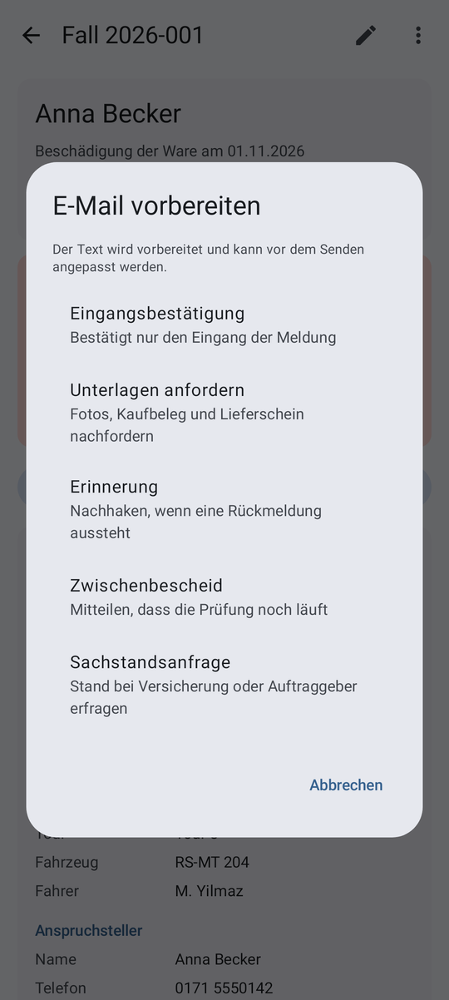

# Schadensfälle

Android-App und Web-App zum **Nachhaken und Bearbeiten von Schadensfällen bei Transportaufträgen**.
Jeder Fall bekommt eine Wiedervorlage; die App zeigt jeden Tag, bei wem nachgehakt werden muss,
und hält fest, was dabei herauskam. Über eine Cloud in Google Drive sehen Handy und Browser
dieselben Fälle – aufgebaut wie bei Tagesdispo und Tourenplanung.

| Übersicht | Fall | Nachgehakt |
|---|---|---|
|  |  |  |

| Anlagen und Verlauf | Textvorlagen | Dunkles Design |
|---|---|---|
|  |  |  |

Die Bilder zeigen erfundene Beispieldaten.

## Was die App kann

**Fälle führen**
- Fall anlegen mit Anspruchsteller, Schaden (Datum, Art, Beschreibung, Ort, geforderter Betrag),
  Transportauftrag (Auftraggeber, Auftrags-Nr., Tour, Fahrzeug, Fahrer, bis zu zwei Beifahrer) und Regulierung
  (Vergleichsbetrag, Zahlungsfrist, Schadennummer der Versicherung)
- Laufende Fallnummer je Jahr (`2026-001`, `2026-002`, …)
- Status: Neu · In Prüfung · Wartet auf Rückmeldung · Bei Versicherung · Vergleich angeboten ·
  Zahlung offen · Erledigt · Abgelehnt
- Fotos direkt aufnehmen, Belege und andere Dateien anhängen

**Nachhaken**
- Wiedervorlage je Fall mit „Wartet auf …“ und nächstem Schritt
- Übersicht sortiert nach Dringlichkeit: überfällige Fälle oben, Reiter *Fällig / Offen / Abgeschlossen / Alle*, Suche über alle Felder
- **Nachgehakt** mit einem Tipp: Kanal und Ergebnis festhalten, nächsten Termin wählen (morgen, 3 Tage, 1 Woche, 2 Wochen, Datum)
- Tägliche Erinnerung per Benachrichtigung zur eingestellten Uhrzeit
- Anrufen, E-Mail und Nachricht direkt aus dem Fall, mit Textvorlagen:
  Eingangsbestätigung, Unterlagen anfordern, Erinnerung, Zwischenbescheid, Sachstandsanfrage

**Nachvollziehen und Weitergeben**
- Verlauf je Fall: Statuswechsel, Termine, Kontakte, Anlagen und Notizen mit Zeitstempel
- Fallliste als CSV für Excel exportieren (Semikolon, deutsches Zahlenformat)
- Zusammenfassung eines Falls als Text teilen
- Backup aller Fälle samt Anlagen als ZIP erstellen und wiederherstellen

Die Textvorlagen sind bewusst **haftungsneutral**: Sie erkennen keine Haftung an und lehnen
sie nicht ab. Ablehnungs- und Vergleichsschreiben entstehen weiterhin außerhalb der App.

## Cloud einrichten (einmalig)

Die Fälle liegen dann in Google Drive im Ordner `Schadensfaelle` (`daten.json`, Anlagen und eine
tägliche Sicherung der letzten 14 Tage). Android-App und Web-App gleichen sich darüber ab.

1. [script.google.com](https://script.google.com) öffnen → **Neues Projekt**, Name z. B. „Schadensfälle Cloud“.
2. Den Inhalt von [`cloud/Code.gs`](cloud/Code.gs) vollständig in `Code.gs` einfügen und speichern.
3. **Bereitstellen → Neue Bereitstellung → Typ „Web-App“**: *Ausführen als: Ich*,
   *Zugriff: Jeder*. Google fragt einmal nach der Berechtigung für Google Drive.
4. Die angezeigte Adresse (endet auf `/exec`) kopieren.
5. In der Android-App unter **Einstellungen → Cloud** (oder in der Web-App unter ⚙) die Adresse
   eintragen und **Verbinden** tippen. Beim ersten Gerät wird eine **PIN** festgelegt
   (mindestens 6 Zeichen), auf allen weiteren Geräten wird sie einmal abgefragt.

Vorhandene Fälle auf dem Handy werden beim ersten Verbinden hochgeladen.

- **Zugriff:** „Jeder“ heißt: Wer die Adresse kennt, kann das Skript aufrufen – an die Daten kommt
  er nur mit der PIN. Nach acht falschen Eingaben ist das Skript eine Stunde gesperrt.
- **PIN vergessen:** Im Skript-Editor die Funktion `pinZuruecksetzen` ausführen; danach in der
  App eine neue PIN festlegen. Die Daten bleiben erhalten.
- **Skript geändert:** Bereitstellen → Bereitstellungen verwalten → Bearbeiten → *Neue Version*.
  So bleibt die Adresse gleich.

**Regeln beim Abgleich:** Wird ein Fall auf zwei Geräten bearbeitet, gilt die spätere Änderung.
Gelöschtes bleibt überall gelöscht. Ohne Netz wird normal weitergearbeitet; die Änderungen
gehen hoch, sobald wieder eine Verbindung besteht. Vergeben zwei Geräte offline dieselbe
Fallnummer, bekommt der später abgeglichene Fall die nächste freie Nummer.

## Web-App

Die Web-App ([`web/`](web/)) bietet dieselben Funktionen wie die Android-App, im Browser auf PC,
Tablet oder Handy. Sie lässt sich wie eine App installieren („Zum Startbildschirm hinzufügen“)
und funktioniert auch ohne Netz.

**Veröffentlichung:** Der Workflow *Web-App* stellt `web/` bei jedem Stand auf dem Hauptzweig auf
GitHub Pages bereit. Einmalig nötig: unter *Settings → Pages* als Quelle **GitHub Actions** wählen.
Für ein privates Repository setzt GitHub Pages einen kostenpflichtigen GitHub-Tarif voraus –
alternativ den Inhalt von `web/` in ein öffentliches Repository legen, wie bei Tagesdispo.

Damit nicht jedes Gerät die Cloud-Adresse eintragen muss, kann sie in `web/index.html` bei
`window.API_URL` fest hinterlegt werden.

Erinnerungen per Benachrichtigung gibt es nur in der Android-App.

## Installieren

1. In GitHub unter **Actions** den neuesten erfolgreichen Lauf öffnen und unter *Artifacts*
   `Schadensfaelle-debug-apk` herunterladen (ZIP mit der APK-Datei).
2. Die APK auf dem Android-Gerät öffnen und die Installation aus dieser Quelle erlauben.
3. Beim ersten Start unter **Einstellungen** Firma, Bearbeiter/in und Funktion eintragen –
   daraus entsteht die Grußformel der Textvorlagen – und Benachrichtigungen erlauben.

Voraussetzung: Android 8.0 oder neuer.

### Wichtig bei Updates

Die APK aus dem Workflow ist mit einem bei jedem Lauf neu erzeugten Testschlüssel signiert.
Android installiert eine so gebaute neue Version **nicht über die alte**; die App muss vorher
deinstalliert werden, wobei ihre Daten gelöscht werden. Deshalb vor jedem Update:
**Einstellungen → Backup erstellen**, danach neue Version installieren und
**Backup wiederherstellen**. Wer regelmäßig aktualisieren will, sollte einen festen
Signaturschlüssel einrichten.

## Daten und Datenschutz

- Ohne verbundene Cloud liegen alle Daten ausschließlich auf dem Gerät. Mit Cloud liegen sie
  zusätzlich im Google Drive des Kontos, das das Cloud-Skript bereitgestellt hat; die App
  spricht dann nur mit diesem Skript.
- Die PIN wird im Skript nur als Prüfsumme gespeichert, auf den Geräten im privaten App- bzw.
  Browser-Speicher.
- Die automatische Cloud-Sicherung von Android ist abgeschaltet, weil die Fälle
  personenbezogene Kundendaten enthalten. Gesichert wird über das Backup in den Einstellungen
  bzw. über die tägliche Sicherung im Drive-Ordner.
- Anlagen werden in den privaten App-Speicher kopiert; das Original bleibt unverändert.

## Entwickeln

```bash
./gradlew assembleDebug        # APK nach app/build/outputs/apk/debug/
./gradlew testDebugUnitTest    # Tests, erzeugt auch Bildschirmfotos
./gradlew lintDebug            # Android Lint
node --test cloud/test/cloud.test.js           # Cloud-Skript
node --test --test-timeout=90000 web/test/     # Web-App im Browser (benötigt Playwright)
```

Die Abgleich-Tests der Android-App und der Web-App laufen gegen das echte `cloud/Code.gs` in
einer nachgebildeten Google-Umgebung (`cloud/test/`); dafür wird Node.js benötigt.

Benötigt JDK 21 und das Android SDK (Plattform 37 wird bei Bedarf nachgeladen).

| Bereich | Technik |
|---|---|
| Oberfläche | Kotlin, Jetpack Compose, Material 3, Navigation Compose |
| Daten | Room (SQLite), DataStore für Einstellungen |
| Erinnerung | WorkManager, Benachrichtigungen |
| Tests | JUnit, Robolectric, Compose UI Test, Roborazzi |

```
app/src/main/java/de/aysetransport/schaden/
├── data/          Datenbank, Repository, Anlagen-Speicher, Backup, Einstellungen
├── domain/        Fachlogik ohne Android: Fälligkeit, Filter, Beträge, Textvorlagen, CSV
├── erinnerung/    tägliche Prüfung und Benachrichtigung
└── ui/            Übersicht, Fall, Formular, Einstellungen
```

Das Datenbankschema ist unter `app/schemas/` versioniert. Wer Tabellen ändert, muss die
Versionsnummer erhöhen und eine Migration ergänzen, sonst gehen beim Update Daten verloren.

### Tests

Die Tests bedienen die App wie ein Nutzer – Fall anlegen, nachhaken, abschließen, löschen,
Foto und Datei anhängen, E-Mail vorbereiten, exportieren, Backup und Wiederherstellung – und
prüfen Fachlogik, Datenbank und Erinnerung. Sie laufen auf dem Entwicklungsrechner in einer
simulierten Android-Umgebung (Robolectric), nicht auf einem echten Gerät.
Bildschirmfotos landen in `app/build/outputs/roborazzi/`.

## Bekannte Grenzen

- Die Erinnerung kommt ungefähr zur eingestellten Uhrzeit; Android darf sie im Stromsparmodus
  verzögern. Manche Hersteller beenden Hintergrundarbeit sehr streng – dann die App in den
  Akku-Einstellungen von der Optimierung ausnehmen. In der Übersicht stehen fällige Fälle
  unabhängig davon immer oben.
- Eine PIN für alle: Es gibt keine einzelnen Benutzerkonten, und im Verlauf steht nicht, wer
  eine Änderung gemacht hat.
- Ändern zwei Geräte denselben Fall fast gleichzeitig, gewinnt der ganze spätere Stand – Felder
  werden nicht einzeln zusammengeführt. Der Verlauf beider Geräte bleibt vollständig.
